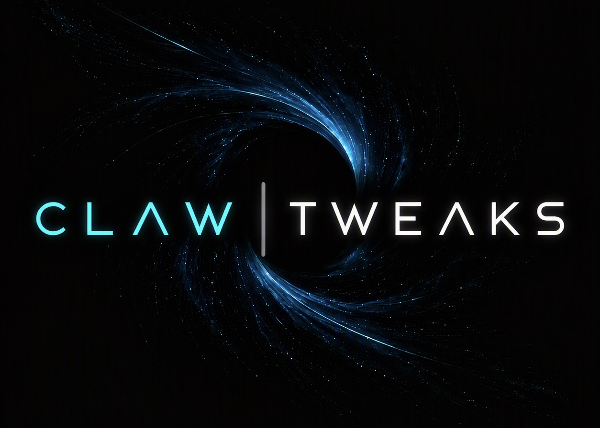
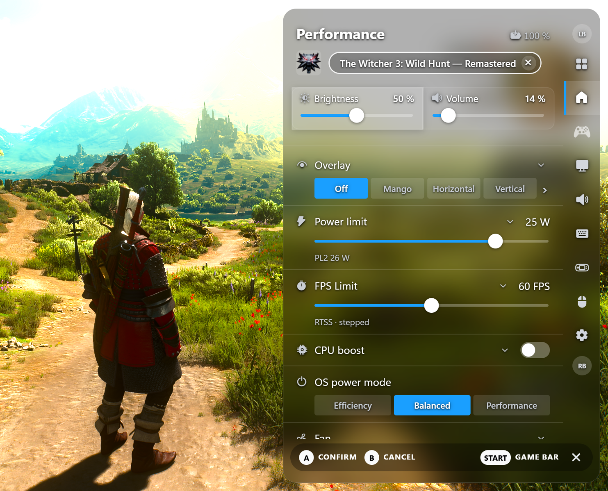
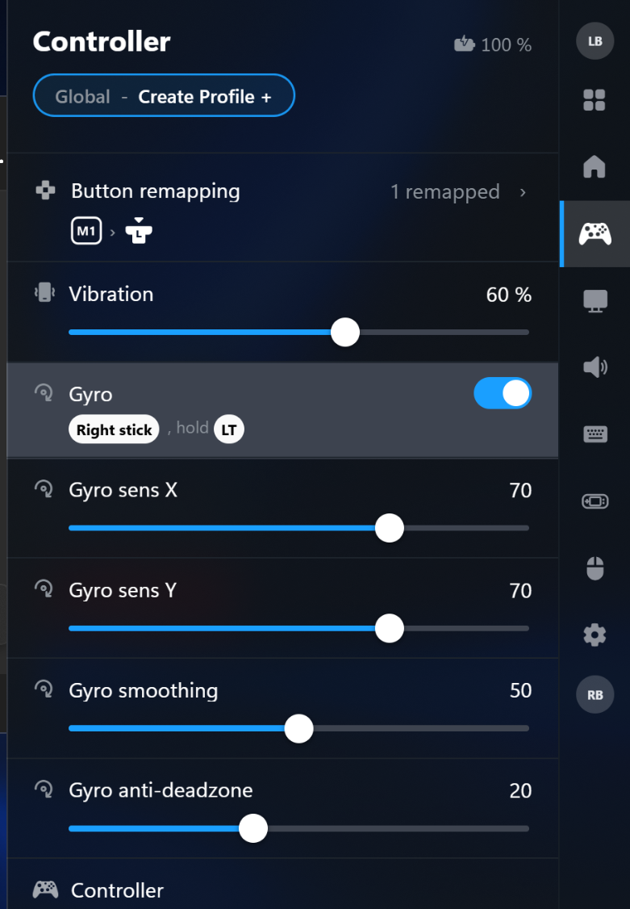
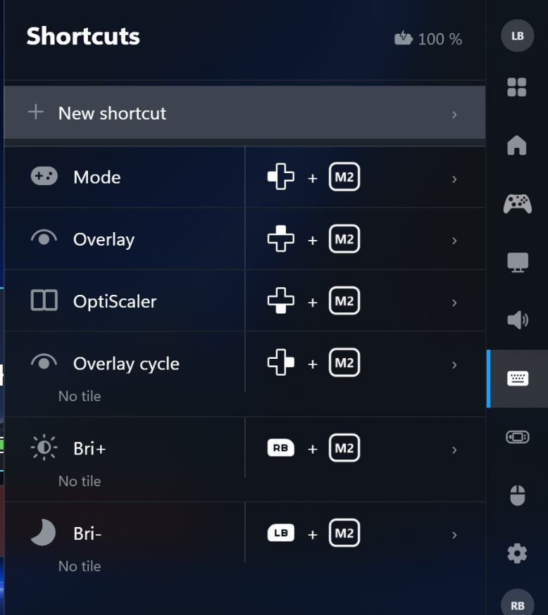
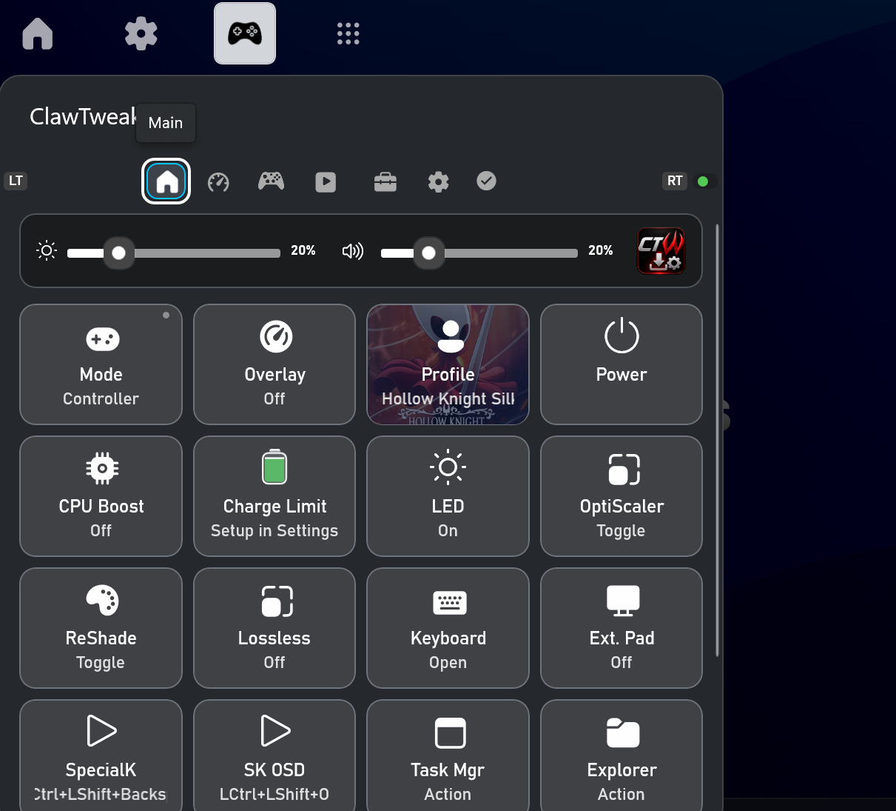
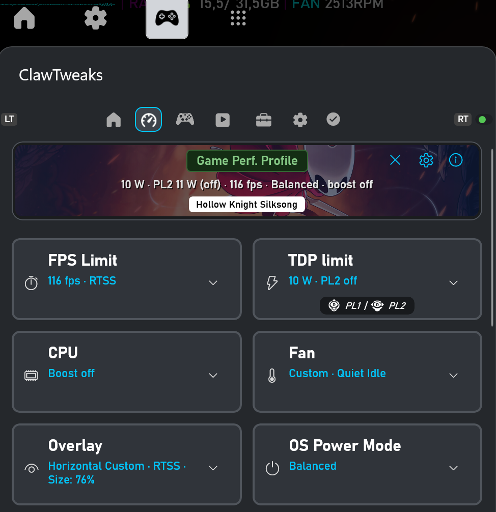
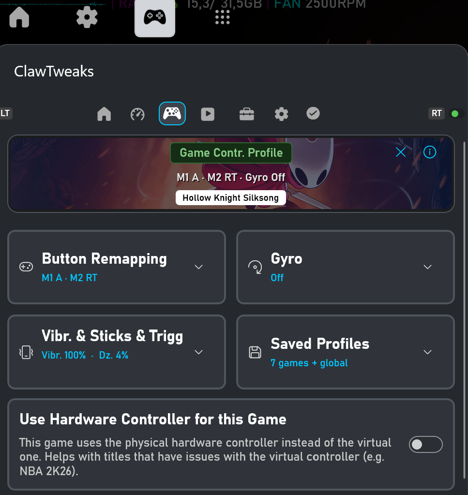

  

  
  
  
  
  
  

**Optimized for Intel MSI Claw handhelds, with deep settings down to saturation and hue per colour channel. Everything works globally or per game.**

Use it in the Quick Access Menu or the Xbox Game Bar.

## Install

1. Install MSI Center M.
2. Download `ClawTweaks_<version>_Setup.exe` from the [latest release](https://github.com/enterTheVoidCode/ClawTweaks/releases/latest) and run it.

| Device | Status |
|---|---|
| MSI Claw 8 AI+ A2VM | ✅ |
| MSI Claw 7 AI+ A2VM / A2VMX | ✅ |
| MSI Claw 8 EX (Panther Lake) | ✅ |
| MSI Claw A1M (Meteor Lake) | ✅ |
| MSI Claw A8 (AMD) | 🚫 |

## QAM or Game Bar: your choice

Use the Quick Access Menu, the Game Bar or both. Both save to the same profiles.

- Choose in the setup what the Game Bar button opens
- Change it later in the Game Bar under Controller / Front Buttons
- In the QAM, Start always opens the Game Bar

## Quick Access Menu (QAM)

- **Stay in your game:** the QAM opens over the running game
- **One button:** open it with the Game Bar button on your device
- **Controller first:** switch tabs with LB and RB, change values with the D-pad and A
- **Your input stays in the menu:** the game does not react while the QAM is open
- **Everything in one place:** performance, controller, display, sound, shortcuts, device and tiles
- **Saved to the right profile:** changes go to the global profile or to the game's profile
- **Your look:** themes, glass blur, panel colour and panel size

> [!NOTE]
> In Windows Full Screen (FSE / Xbox Mode), the QAM works only with the virtual controller.

<table>
  <tr>
    <td width="50%" valign="top"></td>
    <td width="50%" valign="top"></td>
  </tr>
  <tr>
    <td valign="top"><strong>Controller</strong> Button remapping, vibration and gyro, global or per game.</td>
    <td valign="top"><strong>Shortcuts</strong> Button combos for actions and tiles.</td>
  </tr>
</table>

## Game Bar

<table>
  <tr>
    <td width="50%" valign="top"></td>
    <td width="50%" valign="top"></td>
  </tr>
  <tr>
    <td valign="top"><strong>Tiles</strong> Your most-used settings and actions, one press away.</td>
    <td valign="top"><strong>Performance</strong> FPS limit, TDP, CPU, fan, overlay and power mode, global or per game.</td>
  </tr>
  <tr>
    <td width="50%" valign="top"></td>
    <td width="50%" valign="middle"><strong>Open the Game Bar</strong> Press the Game Bar button, or Start in the QAM.</td>
  </tr>
  <tr>
    <td valign="top"><strong>Controller</strong> Button remapping, gyro, vibration and saved profiles, global or per game.</td>
    <td></td>
  </tr>
</table>

## Features

- **Profiles:** global and per game, with separate values on battery and plugged in if you want them
- **Performance:** TDP, FPS limit (Intel or RTSS), CPU boost, CPU limits and OS power mode
- **Fan:** fan modes and your own fan curve
- **Display:** saturation per colour, tints per channel, contrast, gamma, sharpness and Intel scaling
- **Controller:** remap M1 and M2, gyro and mouse actions, per game
- **Steam Input:** Steam can see an Xbox, Steam Deck or DualSense Edge pad
- **Shortcuts:** button combos for tiles and actions, single and double click on the front button
- **Overlay:** presets for RTSS or the built-in overlay
- **Device:** charge limit, LED and battery calibration
- **Library:** optional [CyanNova](https://github.com/enterTheVoidCode/ClawTweaksCenter) game library

## Credits

Built on [GoTweaks](https://github.com/corando98/GoTweaks). Uses [LibreHardwareMonitor](https://github.com/LibreHardwareMonitor/LibreHardwareMonitor), RTSS, [HidHide](https://github.com/nefarius/HidHide), [usbip-win2](https://github.com/vadimgrn/usbip-win2) and [VIIPER](https://github.com/Alia5/VIIPER).

## License

[AGPLv3](LICENSE). Parts from GoTweaks and the Microsoft Game Bar sample stay under [MIT](LICENSE.MIT). See [LICENSING.md](LICENSING.md).
